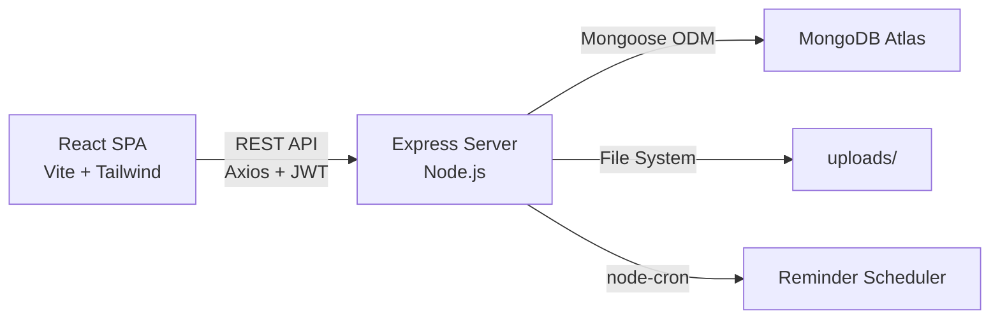
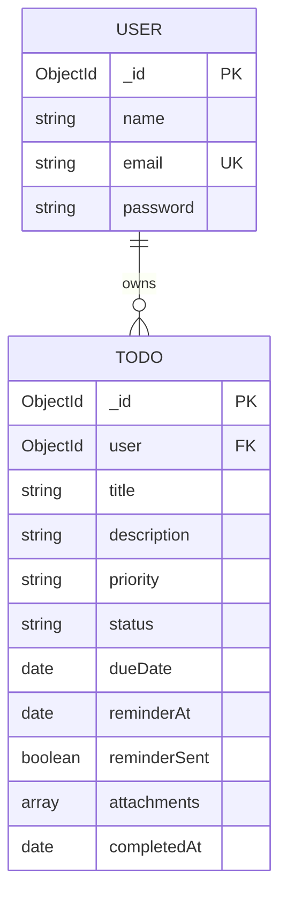
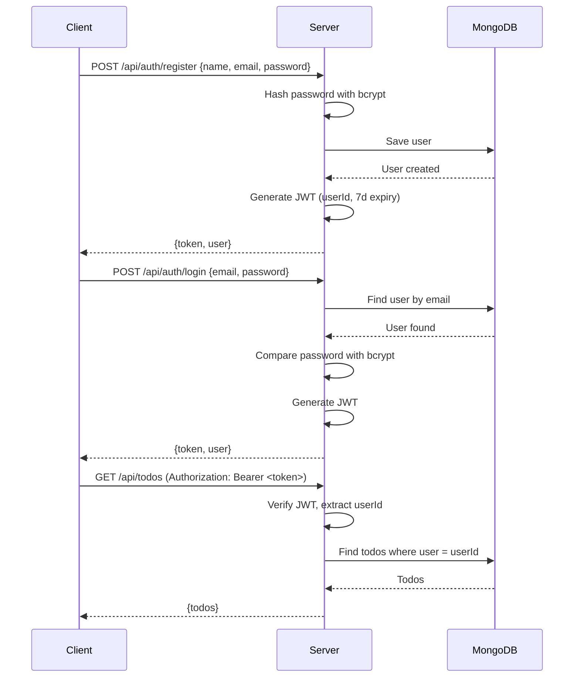

# TaskFlow — Architecture

## System Overview

TaskFlow uses a client-server architecture with a React SPA frontend and a Node.js/Express REST API backend. MongoDB Atlas serves as the database.



## Folder Structure

```
TaskFlow/
├── project-requirement.md
├── architecture.md
├── rules.md
├── phase.md
├── design.md
├── README.md
├── backend/
│   ├── package.json
│   ├── server.js
│   ├── .env
│   ├── .env.example
│   ├── .gitignore
│   ├── config/
│   │   └── db.js
│   ├── models/
│   │   ├── User.js
│   │   └── Todo.js
│   ├── middleware/
│   │   ├── auth.js
│   │   ├── upload.js
│   │   └── errorHandler.js
│   ├── routes/
│   │   ├── auth.js
│   │   └── todos.js
│   ├── controllers/
│   │   ├── authController.js
│   │   └── todoController.js
│   ├── services/
│   │   └── reminderService.js
│   └── uploads/
└── frontend/
    ├── package.json
    ├── vite.config.js
    ├── tailwind.config.js
    ├── postcss.config.js
    ├── index.html
    ├── .env
    ├── .env.example
    └── src/
        ├── main.jsx
        ├── App.jsx
        ├── index.css
        ├── lib/
        │   └── utils.js
        ├── api/
        │   ├── axios.js
        │   ├── auth.js
        │   └── todos.js
        ├── store/
        │   ├── authStore.js
        │   └── todoStore.js
        ├── components/
        │   ├── ui/
        │   ├── layout/
        │   ├── dashboard/
        │   └── todos/
        └── pages/
            ├── LoginPage.jsx
            ├── RegisterPage.jsx
            ├── DashboardPage.jsx
            ├── TodosPage.jsx
            └── ...
```

## Database Schema

### User Collection

| Field | Type | Constraints |
|-------|------|-------------|
| name | String | Required, 2-50 chars |
| email | String | Required, unique, lowercase |
| password | String | Required, min 6 chars, hashed |
| createdAt | Date | Auto (timestamps) |
| updatedAt | Date | Auto (timestamps) |

### Todo Collection

| Field | Type | Constraints |
|-------|------|-------------|
| user | ObjectId | Required, ref: User |
| title | String | Required, 1-200 chars |
| description | String | Optional, max 1000 chars |
| priority | String | Enum: low, medium, high. Default: medium |
| status | String | Enum: pending, completed. Default: pending |
| dueDate | Date | Optional |
| reminderAt | Date | Optional |
| reminderSent | Boolean | Default: false |
| attachments | Array | [{filename, originalName, mimetype, size}] |
| completedAt | Date | Set when status changes to completed |
| createdAt | Date | Auto (timestamps) |
| updatedAt | Date | Auto (timestamps) |



## API Endpoints

### Authentication

| Method | Endpoint | Description | Auth |
|--------|----------|-------------|------|
| POST | /api/auth/register | Register new user | No |
| POST | /api/auth/login | Login user | No |
| GET | /api/auth/me | Get current user | Yes |

### Todos

| Method | Endpoint | Description | Auth |
|--------|----------|-------------|------|
| GET | /api/todos | List user's todos (with filters) | Yes |
| GET | /api/todos/stats | Get dashboard statistics | Yes |
| POST | /api/todos | Create a todo | Yes |
| PUT | /api/todos/:id | Update a todo | Yes |
| DELETE | /api/todos/:id | Delete a todo | Yes |
| PATCH | /api/todos/:id/complete | Toggle completion | Yes |

### Attachments

| Method | Endpoint | Description | Auth |
|--------|----------|-------------|------|
| GET | /api/todos/:id/attachments/:filename | Download attachment | Yes |
| DELETE | /api/todos/:id/attachments/:filename | Remove attachment | Yes |

### Query Parameters (GET /api/todos)

| Param | Type | Description |
|-------|------|-------------|
| status | string | Filter by status |
| priority | string | Filter by priority |
| search | string | Search in title |
| filter | string | today, upcoming, overdue |
| page | number | Page number (default: 1) |
| limit | number | Items per page (default: 20) |

## Authentication Flow



## Attachment Flow

1. Frontend sends FormData with file(s) via multipart/form-data.
2. Multer middleware validates file type (jpg/jpeg/png/webp/pdf) and size (≤5MB).
3. Files are saved to `backend/uploads/` with UUID-generated filenames.
4. Attachment metadata (filename, originalName, mimetype, size) stored in Todo document.
5. Download: auth middleware verifies JWT → controller checks todo ownership → streams file.
6. Delete: auth + ownership check → removes file from disk and todo document.

> **Production note**: Replace local file storage with S3 or Cloudinary for scalability.

## Reminder Flow

1. `node-cron` job runs every 60 seconds on the backend.
2. Finds todos where `reminderAt <= now` AND `reminderSent === false`.
3. Sets `reminderSent = true` on matched todos.
4. Frontend polls `/api/todos` periodically (every 30s).
5. Frontend checks loaded todos: if `reminderSent === true` and not yet notified locally, triggers browser `Notification`.
6. Tracks notified todo IDs in Zustand store (in-memory set).

> **Limitation**: Browser notifications only work while the app tab is open. Production push notifications require Web Push (VAPID keys + service worker).

## Security Architecture

| Layer | Mechanism |
|-------|-----------|
| Password storage | bcrypt with salt rounds = 10 |
| Authentication | JWT with 7-day expiry |
| Authorization | Middleware extracts userId from token; all queries filter by user |
| File upload | Multer whitelist (jpg/jpeg/png/webp/pdf), 5MB limit, UUID filenames |
| File access | Ownership check before serving files |
| Input validation | Server-side validation on all inputs |
| CORS | Restricted to CLIENT_URL |
| Secrets | All credentials in .env, never committed |
